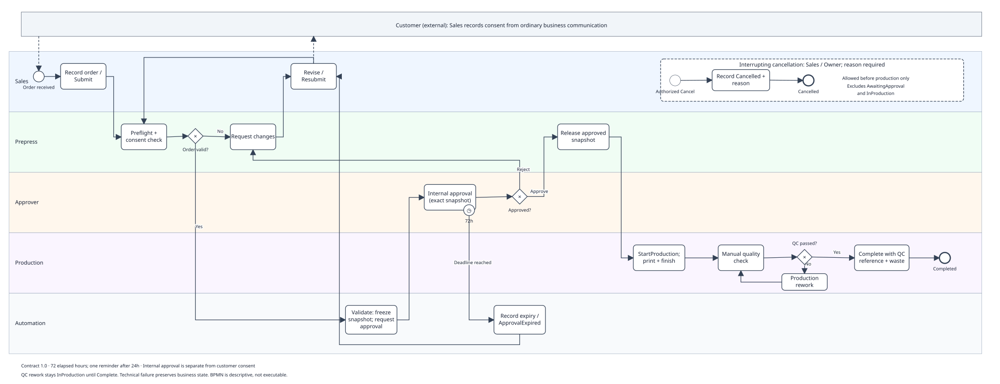

# Copilot Process Kit

A Microsoft 365 implementation kit for made-to-order print orders, from intake and artwork approval to production and quality checks.

[Process](process/process-guide.md) · [Flow guides](flows/README.md) · [Agent setup](copilot/setup-guide.md) · [Power BI](reporting/setup-guide.md) · [Validation](validation/local-report.md)



*Process design preview. Live tenant execution remains pending.*

## Why this project

Print orders depend on customer requirements, artwork revisions, internal approvals and production handoffs. Teams need a clear record of which artwork was approved and who can release it for printing.

This kit models that process in BPMN 2.0 and supplies SharePoint schemas, Power Automate construction guides, a grounded Copilot Studio assistant specification, role-based training and Power BI reporting materials. It targets a 5–15-person pilot.

> [!NOTE]
> The local artifacts and sample data are implemented and validated. Microsoft flows and the agent must be constructed in a tenant. Power BI requires manual model setup. This repository contains no importable Microsoft solution, PBIX or live deployment results.

## Run the local checks

Requirements: Git and Python 3.9+ with the standard library. No packages or Microsoft credentials are required.

```sh
git clone https://github.com/MaheshBhushan/copilot-process-kit.git
cd copilot-process-kit
python3 scripts/generate_samples.py
python3 scripts/validate.py
```

The generator rewrites six synthetic CSV/JSON files. The validator checks their contracts, histories, metrics and cross-references, then writes [the local verification report](validation/local-report.md).

Expected final output:

```text
PASS 12 validation groups; exit 0; wrote validation/local-report.md
```

The scripts also accept invocation by absolute path from another working directory. The [data guide](data/README.md) explains the fixtures and their provenance.

## What is included

| Area | Artifacts |
|---|---|
| Process analysis | [BPMN XML](process/print-order.bpmn), diagram and [lifecycle contract](contracts/process.json) |
| SharePoint | [List and library provisioning](sharepoint/provisioning-guide.md), [field schema](contracts/sharepoint-schema.json) and [permissions matrix](sharepoint/permissions-matrix.csv) |
| Power Automate | Four [action-by-action flow guides](flows/README.md), [96 mapped actions](flows/action-map.csv) and [expression recipes](flows/expressions.md) |
| Copilot Studio | [Authenticated, read-only agent setup](copilot/setup-guide.md), approved knowledge documents and [28 evaluation cases](copilot/evaluation-cases.csv) |
| User enablement | Guides for [Sales](training/sales-guide.md), [Prepress](training/prepress-guide.md), [Approvers](training/approver-guide.md), [Production](training/production-guide.md) and [Owner/admin](training/owner-admin-guide.md); [16 prompt templates](training/prompt-library.md) |
| Change management | [Pilot rollout plan](rollout/change-plan.md), competency checks and [communication drafts](rollout/communications.md) |
| Power BI | [Model setup](reporting/setup-guide.md), Power Query M, DAX and [dashboard layout](reporting/dashboard-layout.md) |
| Deployment | [Runbook](deployment/runbook.md), recovery procedures and [35 acceptance cases](deployment/acceptance-cases.csv) |

## How the process works

Staff submit commands to SharePoint. A dispatcher validates roles and revisions before changing an order. A separate worker handles approval waits; notification and watchdog flows handle delivery and exceptions.

Prepress freezes the artwork submitted for internal approval. Production uses that approved snapshot. Customer consent is recorded separately from internal approval. Uncertain file, approval or notification effects require operator reconciliation.

The assistant answers procedural questions from approved SharePoint knowledge. It has no order-writing or approval actions. Reporting separates order events from assistant usage.

See the [process guide](process/process-guide.md) for lifecycle rules and the [detailed handoff](.scratch/implementation-handoff.md) for architecture and contracts. The [execution plan](.scratch/execution-plan.md) records task boundaries and verification gates.

## Local verification

The standard-library validator checks the committed fixtures and independently recalculates their metrics.

| Check | Verified local scope |
|---|---|
| Process and data | 60 synthetic orders, 12 users and 255 legal transition events |
| Usage | 147 separate synthetic activity records |
| Reporting inputs | 22 reconciled metrics, including weekly and status buckets |
| Traceability | 96 flow-action references plus BPMN references and diagram layout |
| Reproducibility | Identical SHA256 hashes across two generator runs, including a run outside the project directory |
| Tenant readiness | 35 acceptance cases and 28 agent evaluations populated; all live results pending |

These checks establish local artifact consistency. They do not execute M, DAX, Microsoft connectors, flows, agent responses or permission boundaries. See [verification evidence](validation/local-report.md), [determinism hashes](validation/determinism.json) and the [artifact manifest](manifest.json).

## Deploy to Microsoft 365

Start with the [deployment runbook](deployment/runbook.md). It covers licensing, environment policy, identities, connections, permissions, disabled-first configuration, acceptance and rollback. Use the [example environment](config/environment.example.json) as a template; keep private configuration out of Git.

> [!IMPORTANT]
> File handling currently requires the deprecated SharePoint **Copy file** action for explicit destination filenames and no-overwrite behavior. Deployment stays on hold if those semantics cannot be demonstrated. Any replacement needs approval and tenant tests before automation is enabled.

The remaining work requires a tenant: construct and test the flows, publish and evaluate the agent, build the Power BI model, verify access and capture live adoption data. No tenant execution or measured business improvement is claimed.

## Author and feedback

Created by [Mahesh Koduri](https://github.com/MaheshBhushan). Report reproducible problems through [GitHub Issues](https://github.com/MaheshBhushan/copilot-process-kit/issues), with the affected artifact and redacted evidence.

This repository currently has no license file.
